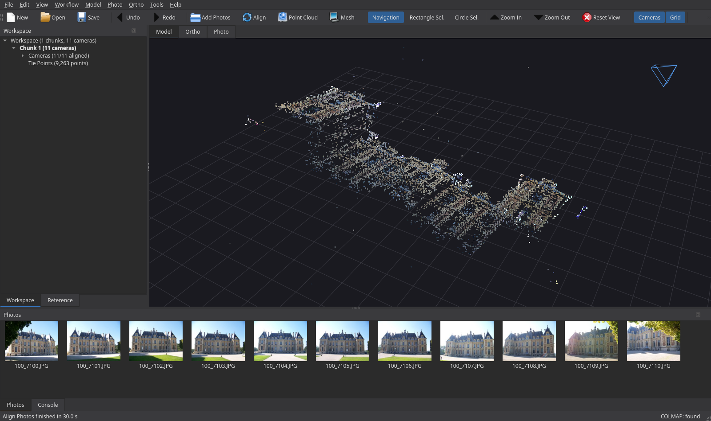

# PhotoMesh Studio

An open-source photogrammetry desktop application (Python + PySide6) with a
familiar professional photogrammetry workflow: **Add Photos → Align Photos →
Build Point Cloud → Build Model**. Reconstruction is done by
[COLMAP](https://colmap.github.io/) (BSD licence) driven by our own speed
pipeline **fastpipe**.

The menu layout follows the publicly documented command list of mainstream
photogrammetry suites (source used: the *Menu commands* appendix of the public
Agisoft Metashape Professional user manual,
<https://www.agisoft.com/pdf/metashape-pro_2_3_en.pdf>). All code, styling and
icons are original (Qt standard icons); no third-party application files were
inspected or copied. PhotoMesh Studio is not affiliated with Agisoft.



## Install and update on Windows

Download the [latest release](https://github.com/behdad-nayyerpour/photomesh-studio-improved/releases/latest), then run **PhotoMeshStudio_Setup_0.1.15.exe**. It is a
single offline installer containing Python, the required packages, COLMAP, and
GLOMAP. It creates a Start menu shortcut and can optionally create a desktop
shortcut. Python and Git do not need to be installed separately.

For each later release, close the app and run the matching
**PhotoMeshStudio_Update_<version>.exe**. It installs the new program files;
when the Python runtime changes, the update includes that too. Projects,
original photos, and processing results are stored outside the installer and
are not removed. The update checks that PhotoMesh Studio is already installed
in the selected folder.

To work from source instead of using the installer:

```powershell
git clone https://github.com/behdad-nayyerpour/photomesh-studio-improved.git
cd photomesh-studio-improved
.\setup.bat
.\run.bat
```

The private repository may ask you to sign in to GitHub during cloning. Source
installations can use `update.bat`; EXE installations use the versioned update
EXE. See [UPDATING.md](UPDATING.md).

### Install COLMAP when running from source

The app finds COLMAP automatically in this order: *Tools → Preferences →
Advanced* path, `PATH`, then a bundled copy in `tools\colmap` next to (or one
level above) the app folder, then `C:\COLMAP`.

1. Pick the build that matches your NVIDIA driver (`nvidia-smi` shows it):
   * driver **≥ 580**: newest release, `colmap-x64-windows-cuda.zip` (CUDA 13);
   * driver **527–579**: COLMAP 3.10 – 3.13 `...-windows-cuda.zip` (CUDA 12);
   * driver **< 527** (e.g. 512.x): **COLMAP 3.8** `COLMAP-3.8-windows-cuda.zip`
     (CUDA 11; the newest official CUDA-11 Windows build);
   * no NVIDIA GPU: newest `...-windows-nocuda.zip` (no dense point cloud).
   Downloads: <https://github.com/colmap/colmap/releases>
2. Unzip it into `tools\colmap` (so that `tools\colmap\COLMAP.bat` exists), or
   anywhere else plus PATH / Preferences.
3. The status bar shows `COLMAP: found` when it is detected.

### Install GLOMAP (optional, much faster alignment of large photo sets)

Download `glomap-x64-windows-nocuda.zip` (1.2.0 or newer) from
<https://github.com/colmap/glomap/releases> and unzip it into `tools\glomap` so
that `tools\glomap\bin\glomap.exe` exists. The CPU build works with every
NVIDIA driver (GLOMAP's heavy steps run on the CPU, multi-threaded). GLOMAP
reads the COLMAP database the app writes.

### Offline

PhotoMesh Studio never uses the network at run time: COLMAP, GLOMAP and all
Python packages run locally, no vocabulary trees or models are downloaded, and
*Help → Contents* opens the local README. The EXE installer is offline. Source installations need internet for package
installation, and the standalone update EXE needs no network access. The test suite runs with
sockets blocked. Open3D (meshing) is imported only inside the meshing task and
makes no network connections (checked with a connection monitor during a full
dense + mesh run).

Dense point clouds (*Build Point Cloud*, and *Build Model* from depth maps) need
the **CUDA** build and an NVIDIA GPU; the app checks this and tells you.
Alignment and *Build Model* from tie points / point cloud also work on CPU.

## Using it

1. *Workflow → Add Photos…* / *Add Folder…* — photos are analysed in parallel
   (EXIF GPS, thumbnails, global descriptors) and appear in **Photos**,
   **Workspace** and **Reference** panes.
2. *Workflow → Align Photos…* — Accuracy, matching mode (**Fast** default /
   Exhaustive / Sequential), **camera estimation** (Auto / Global / Incremental /
   Hierarchical), coarse-to-fine, key point limit, guided matching…
   Result: camera positions + tie points in the **Model** view.
3. *Workflow → Build Point Cloud…* — Quality + Depth filtering (CUDA).
4. *Workflow → Build Model…* — Source (Depth maps / Point cloud / Tie points),
   surface type, face count.
5. *File → Save* stores a `*.pmsx` project (JSON); results live in
   `<project>.files/`.

## fastpipe — the speed pipeline (default "Fast" mode)

Original implementation of published techniques:

| Stage | What it does |
|---|---|
| Parallel analysis | EXIF, thumbnails and descriptors computed in a process pool (cached). |
| Pair preselection | Union of (a) GPS k-nearest neighbours, (b) top-k global-descriptor similarity (GIST-like gradient grid + tiny image), (c) sequential window. Fed to COLMAP `matches_importer`, so matching cost is **O(n·k)** instead of **O(n²)** (e.g. a 200-photo grid survey: ~1 300 GPS+sequence pairs, ≤ ~2 900 with descriptor pairs, instead of 19 900). |
| Coarse-to-fine | Align at 1024 px first, then extract full-accuracy features, match only pairs co-visible in the coarse model, triangulate into the coarse poses (`point_triangulator`), register the photos the coarse stage missed (`image_registrator`), triangulate again and run one `bundle_adjuster` — never a second full SfM (that is only a fallback if the refinement fails). |
| Camera estimation | **Auto** (default): GLOMAP global SfM for 100+ photos when bundled, else incremental. **Global**: GLOMAP solves all cameras at once (rotation averaging + global positioning). **Incremental**: COLMAP mapper tuned for speed (all threads, fewer/shorter global BAs). **Hierarchical**: COLMAP `hierarchical_mapper`, scene split into parallel sub-models. Global/Hierarchical fall back to incremental if they fail. |
| Decode once | Photos are decoded once (JPEG DCT downscale, process pool) into working images in the project folder (never the photo folder); COLMAP detects on them and key points/cameras are rescaled to full resolution; deleted after alignment. |
| Feature selection | Fine stage keeps 18 000 features/photo at Medium (24 000 High): mostly the best-localised small-scale ones plus the most repeatable large-scale ones — 4× faster GPU matching than 50 k features. |
| GPU | SIFT extraction/matching GPU flags on (toggle in Preferences → GPU). |

Benchmark: `python benchmark.py <image_folder> [--modes fast exhaustive sequential] [--mapper Auto Global Incremental Hierarchical] [--no-gpu]`.
On the 11-image OpenMVG *Sceaux Castle* set (CPU only, no GPU) all modes register
11/11 images with ~0.52 px reprojection error and take ~70 s; Fast replaces the
final incremental mapper (14.4 s) with triangulation + BA (2.4 s), but with so
few photos almost all pairs overlap, so the matching saving only shows on
larger sets (hundreds of photos).

Drone survey, 641 DJI Mavic 3 Pro photos (597 wide 5280×3956 + 44 tele 4032×3024), Medium accuracy, Fast mode,
RTX 3080 Laptop + Ryzen 9 5900HX, COLMAP 3.8 CUDA + GLOMAP 1.2:

| | first Fast run | GLOMAP + refinement fix | speed-ups | current (mixed cameras) |
|---|---|---|---|---|
| total | > 77 min (unfinished) | 38.6 min | 12.6 min | 15.2 min† |
| aligned | – | 596/641 | 596/641 | **640/641** |
| tie points | – | 1.17 M | 0.59 M | 0.62 M |
| reprojection error | – | 0.98 px* | 1.11 px | 1.09 px |

*recomputed after point filtering (the 1.02 px reported then was a pre-BA value).
†the fine stage took about the same time as before (+7 %, 44 more photos); most of the
extra time was in photo reading (EXIF analysis, decoding), which was slower on that run.

Mixed cameras: COLMAP's `single_camera` option silently *skips* every photo whose
size differs from the first one, which dropped all 44 tele (70 mm) photos of the
Mavic 3 Pro. PhotoMesh Studio now extracts per photo and then shares one camera per
group of identical lens + image size ("2 camera group(s): 597 photos, 44 photos" in
the Console). Photos that still don't align are listed in the Console after Align
Photos (here only the last frame, an oblique shot at landing with no overlap).
Current speed-ups: photos decoded once in parallel into downscaled working
images (key points rescaled to full resolution); fine-stage feature selection
(18 000/photo: 80 % smallest-scale for precision + 20 % largest for robustness);
GLOMAP binary output; no second triangulation when no photo was added; bundle
adjustment stops on convergence; tie point colours sampled from the working
images instead of COLMAP re-reading every full-size photo.

## Dense cloud, filtering, mesh and ground control

**Build Point Cloud** (Workflow menu) – own parallel undistortion (photos are read in
place and never written to; downscaled undistorted copies go to `<workdir>\dense`),
quality Ultra/High/Medium/Low/Lowest = 1/2/4/8/16× downscale, one undistorted
pinhole camera per camera group, PatchMatch neighbours chosen from the sparse model
(shared tie points × triangulation-angle weight, 8 per photo by default),
geometric consistency, depth filtering Disabled/Mild/Moderate/Aggressive mapped to
PatchMatch/fusion thresholds, then outlier filtering (minimum confidence = photos
per point, terrain sanity check, statistical and radius outlier removal; scipy
cKDTree, multi-threaded). Depth maps can be reused when the settings are unchanged.

**Tools > Point Cloud > Filter Point Cloud / Filter by Confidence**, **Model >
Gradual Selection** (tie points: reprojection error, reconstruction uncertainty,
image count, projection accuracy).

**Build Model** – Poisson (Open3D) with density trimming (Interpolation
Disabled/Enabled/Extrapolated), or Delaunay from the depth maps; face count
High/Medium/Low (points/5, /15, /45 as in Metashape) or Custom, quadric decimation,
removal of faces bridging gaps, long-edge faces and small components; automatic
voxel downsampling above 12 M points so big clouds fit in RAM.

**Ground control** – File > Import > Import Markers / Import Reference reads
Metashape reference exports (`# CoordinateSystem:` + `#Label X Y Z ...`, as
exported by Metashape), plain label/X/Y/Z[/accuracy] text or CSV, Metashape
markers XML (with photo projections and pinned flags) and survey XML.
Coordinate systems: local (metres), WGS84 lon/lat/alt and UTM (own conversion,
no PROJ data needed). The **Markers** pane lists reference, error (m), projections and
pixel error; the check box switches control ↔ check point. In the Photo view,
right-click places the selected marker or removes one; predicted positions are drawn in
blue. **Tools > Markers > Refine Markers** predicts every marker in every photo and
refines it locally (template from a pinned placement, else a checkerboard-corner
detector, multi-view consensus). **Tools > Optimize Cameras** runs a robust Helmert
fit followed by a GCP-constrained bundle adjustment (Levenberg–Marquardt with Schur
complement: poses, f/cx/cy/k1-k3/p1/p2 per camera group, tie points, markers;
accuracies as in Metashape: markers 0.005 m, projections 0.5 px, tie points 1 px,
camera GPS 10 m). Check points are not used in the adjustment. The report
(File > Export > Export Markers) contains X/Y/Z/total error and pixel error per
marker and the control/check RMSE.

## Texture and tiled model

**Workflow → Build Texture** (Diffuse map from Images). Mapping mode Generic /
Adaptive orthophoto / Orthophoto / Keep uv; blending Mosaic (default) / Average /
Max intensity / Min intensity / Disabled; texture size × count (count is an upper
bound: pages are never filled with texels upsampled past the photo resolution);
hole filling; ghosting filter; photos at working resolution (≤ 2640 px, fast) or
full resolution.

How it works (own code): the original photos are used with the current aligned
cameras (full COLMAP distortion model, any number of sensors). Every face is
ray-cast (Embree) against every camera that can see it, and scored by projected
area × viewing angle × distance to the image border × photo sharpness, top 10 views
per face. Exposure differences between photos are equalised (log-space least
squares), the ghosting filter drops views whose colour differs strongly from the
per-face median (moving vehicles, people), view selection is a smoothness-weighted
labelling (few seams), seams are levelled by per-vertex colour offsets, faces no
photo sees are filled from neighbouring colours. Charts are packed into the
atlas and sampled multithreaded. Visibility is cached (`visibility_cache.npz`), so
re-texturing with other settings is ~40 % faster.

Output in `<project>.files/…/texture/`: `model_textured.obj/.mtl`, `texture_N.jpg`,
`model_textured.glb`, `uv.npz`, `info.json`. The workspace row reads
`3D Model (N faces, …, Texture 8192x8192)`; Properties lists texel size vs photo
ground resolution (cm/pix when the chunk is georeferenced, model units otherwise).

**Workflow → Build Tiled Model** from the model (with its texture, or vertex colours)
or from the point cloud. Adaptive quadtree on the ground plane (z when georeferenced,
otherwise the mean camera up direction), leaves keep every original face, parents
are quadric-decimated with locked borders; every tile has its own atlas baked from
the full model. Output `tiled/`: Cesium 3D Tiles `tileset.json` + `tiles/*.b3dm`
(or `.glb` for 3D Tiles 1.1, `.pnts` for point clouds) and `photomesh_tiles.json`
for our viewer, which streams levels by screen-space error (16 px). Georeferenced
UTM/WGS84 chunks get an ENU→ECEF root transform (Cesium places them on the globe);
local-CRS chunks are written in local metres.

**File → Import → Import Texture… / Import Tiled Model…** attach an existing output
folder without rebuilding (e.g. a texture built from the command line or copied from
another PC). Import Texture needs the folder with `info.json`, `uv.npz` and
`texture_N.jpg` and refuses a texture of a different mesh (face count must match);
Import Tiled Model needs the folder with `tileset.json` + `photomesh_tiles.json`.
Paths are stored in the `.pmsx` on the next Save.

Real project (641 DJI photos, 1.85 M faces, RTX 3080 laptop): texture 8192×1 167 s
(25.7 cm texel – a 1.5 km² site needs more pages: 8192×4 = 12.9 cm, 157 s);
tiled model 45 s (106 tiles, 5 levels); point-cloud tiles from 27.8 M points 12 s.

## Feature status

**Working**

- File: New, Open, Append, Save, Save As, Exit; Export Point Cloud / Model (PLY),
  Export Cameras (CSV), Export Reference (CSV), Generate Report (HTML);
  Import Point Cloud / Model (PLY).
- View: Zoom In/Out, Reset View, Capture View, Full Screen, all Panes toggles
  (Workspace, Reference, Properties, Photos, Console, Jobs), Toolbar.
- Workflow: Add Photos, Add Folder, Align Photos, Build Point Cloud, Build Model,
  Build Texture, Build Tiled Model, Merge Chunks (merges photos into a new chunk).
- Model: Show Cameras, Show Grid, Show Tiled Model, Perspective/Orthographic, Predefined views,
  Model – Textured (texture atlas, GLSL shader; vertex colours when no texture was built) /
  Shaded/Solid/Wireframe, Tiled Model – Textured/Solid/Wireframe/Elevation, Tie Points – Colors,
  Point Cloud – Colors/Solid.
- File: Export Model as OBJ+MTL+JPG/PNG, binary glTF (.glb), textured PLY or PLY;
  Export Tiled Model as a folder or zip (Cesium 3D Tiles).
- Photo: Open Next/Previous Photo; Edit: Rotate Left/Right (photo view).
- Tools: View Model Statistics, Run Script (Python), Preferences, Optimize Cameras,
  Markers > Add Marker / Refine Markers, Point Cloud > Filter Point Cloud /
  Filter by Confidence; Model: Gradual Selection; File: Import/Export Markers,
  Export Reference.
- Help: Contents (this README – the app stays offline), Report a Problem, Open Log Folder, About.
- Workspace context menu: Add / Rename / Duplicate / Remove / Activate chunk,
  enable/disable camera. Console: live Python (`app`, `window`, `project`).

Since 0.1.12 the menus contain only commands that work: the earlier
"not implemented yet" placeholders (selection/drawing/mask tools, region and
transform tools, basemaps, cloud and batch processing, laser scans, classification,
most Tools sub-menus, the Timeline/Animation panes, ...) were removed;
`photomesh/menus.py` (REMOVED_0112) lists them.

## Tests

```bat
run_tests.bat                       (Windows, unit + GUI tests)
run_tests.bat C:\path\to\photos     (also real COLMAP alignment tests)
set "PM_TEST_DENSE=1" && run_tests.bat C:\path\to\photos   (also GPU dense + mesh)
QT_QPA_PLATFORM=offscreen python -m pytest -q        (Linux/macOS)
```

`tests/test_texture_tiles.py` checks the texture against a synthetic scene with
known colours (all mapping/blending modes, ghosting, Keep uv, exports), the 3D Tiles
structure, LOD selection and the GUI actions in both georeferenced and local frames.

26 tests trigger every menu action (with and without COLMAP), all dialogs,
project save/load, panes, error handling and fastpipe internals. Setting
`PM_TESTDATA=<folder with photos>` additionally runs real COLMAP alignment
through the GUI in Fast and Exhaustive modes.

---

## راهنمای فارسی

**PhotoMesh Studio** یک نرم‌افزار فتوگرامتری متن‌باز با پایتون و PySide6 است که
منوها و روند کارش شبیه نرم‌افزارهای حرفه‌ای فتوگرامتری است (بر اساس مستندات عمومی).
همه‌ی کدها، ظاهر و آیکون‌ها از خودمان است.

**نصب روی ویندوز:** فایل `PhotoMeshStudio_Setup_0.1.15.exe` را اجرا کنید.
این یک فایل نصبی آفلاین است و پایتون، COLMAP و GLOMAP را همراه دارد.
برای هر نسخهٔ بعدی، برنامه را ببندید و فایل
`PhotoMeshStudio_Update_<version>.exe` همان نسخه را اجرا کنید.
پروژه‌ها و عکس‌های اصلی سر جای خود می‌مانند. راهنما: [UPDATING.md](UPDATING.md).

برای اجرای کد منبع به‌جای فایل نصبی، دستورهای بخش انگلیسی را اجرا کنید.
ساخت ابر نقاط متراکم به کارت NVIDIA و نسخهٔ سازگار CUDA نیاز دارد.

**روند کار:** Workflow → Add Photos ← Align Photos ← Build Point Cloud ← Build Model.
حالت پیش‌فرض همترازسازی **Fast** است (انتخاب هوشمند جفت عکس‌ها با GPS و شباهت تصویر،
و همترازسازی درشت به ریز) که برای تعداد زیاد عکس خیلی سریع‌تر از Exhaustive است.
منو فقط فرمان‌هایی را نشان می‌دهد که در برنامه پیاده‌سازی شده‌اند.

**بافت و مدل کاشی‌شده:** منوی Workflow ← Build Texture بافت مدل را از عکس‌های اصلی می‌سازد
(حالت‌های Generic / Adaptive orthophoto / Orthophoto / Keep uv و ترکیب Mosaic / Average / Max / Min / Disabled،
پر کردن حفره‌ها و فیلتر سایه‌ی اجسام متحرک). خروجی: OBJ + MTL + JPG و glb در پوشه‌ی `texture`.
در نمای Model – Textured بافت واقعی با شیدر نمایش داده می‌شود.
Workflow ← Build Tiled Model از مدل (با بافت) یا ابر نقاط، یک مدل کاشی‌شده‌ی چندسطحی (LOD) با قالب
Cesium 3D Tiles می‌سازد که نمایشگر برنامه بر اساس فاصله، سطح مناسب را بارگذاری می‌کند.
اندازه‌ی پیکسل در پروژه‌های زمین‌مرجع بر حسب cm/pix و در غیر این صورت بر حسب واحد مدل گزارش می‌شود.
اگر بافت یا مدل کاشی‌شده قبلاً ساخته شده (مثلاً روی کامپیوتر دیگر یا خارج از پروژه)، لازم نیست دوباره ساخته شود:
از منوی File ← Import گزینه‌ی **Import Texture...** را بزنید و پوشه‌ای را که `info.json` و `texture_0.jpg` دارد انتخاب کنید
(بافت باید مال همین مش باشد، یعنی تعداد وجه‌ها یکی باشد)، و برای مدل کاشی‌شده **Import Tiled Model...** و پوشه‌ای که `tileset.json` دارد.
بعد Save بزنید تا در پروژه ذخیره شود.
